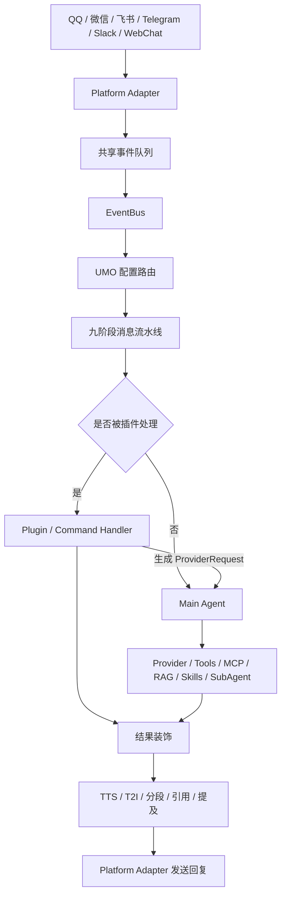

# AstrBot 项目阅读总结

> 基于 `master` 分支提交 `fc6b326fc9012873c4adc0183256c90d34a3d912` 的静态源码阅读。
>
> 项目版本：`4.29.1`；阅读日期：2026-10-19。

## 1. 项目概览

AstrBot 是一个开源的一站式 Agent 聊天机器人平台。它不仅封装了大语言模型调用，还提供了即时通信平台接入、插件系统、知识库、工具调用、MCP、Skills、SubAgent、定时任务、Web 管理面板和运行观测能力。

项目整体采用以下技术栈：

- 后端：Python、`asyncio`、FastAPI、Hypercorn、SQLModel、SQLAlchemy、SQLite。
- 前端：Vue 3、Vite、Vuetify、Pinia、Vue Router、Axios。
- Agent：内置 Tool Loop，同时支持 Dify、Coze、阿里云百炼、DeerFlow 等第三方 Agent Runner。
- 知识库：SQLite、FAISS、FTS5、BM25、Embedding 与可选 Rerank。
- 扩展：Plugin/Star、MCP、Skills、自定义 Platform 和 Provider。
- 部署：CLI、Docker Compose、桌面客户端和启动器。
- 许可证：AGPL-3.0-or-later。

仓库约有 1,842 个受 Git 管理的文件；Python、Vue、TypeScript、JavaScript 和测试代码合计约 34.9 万行，包含 216 个 Python 测试文件。

## 2. 总体架构



从系统边界看，AstrBot 可以分为两部分：

1. **数据平面**：接收平台消息、执行插件或 Agent、调用模型和工具、返回消息。
2. **控制平面**：通过 Dashboard 管理平台、模型、插件、知识库、会话、权限和系统设置。

## 3. 启动与生命周期

程序入口为 [`main.py`](main.py)。主要启动过程如下：

1. 执行运行时 CA/SSL 初始化。
2. 提前解析 `--reset-password`。
3. 检查 Python 运行环境。
4. 创建配置、插件、临时文件、知识库和私有依赖目录。
5. 验证本地 Dashboard 静态资源；缺失时尝试下载匹配版本。
6. 创建 `InitialLoader`。
7. 初始化 `AstrBotCoreLifecycle`。
8. 并行运行核心服务和 Dashboard。

核心生命周期位于 [`astrbot/core/core_lifecycle.py`](astrbot/core/core_lifecycle.py)，负责按顺序初始化：

- 主数据库与共享偏好设置；
- HTML/T2I 渲染器；
- UMO 配置路由器与多配置管理器；
- 数据迁移；
- Persona Manager；
- Provider Manager；
- Platform Manager；
- Conversation Manager；
- 平台消息历史；
- Knowledge Base Manager；
- Cron Job Manager；
- SubAgent Orchestrator；
- Plugin Context 与 Plugin Manager；
- 每个配置文件对应的 Pipeline Scheduler；
- EventBus、更新器和后台诊断任务。

停止时会依次取消后台任务，关闭 Cron、本地 Computer Runtime、插件、Provider、Platform、知识库和数据库连接。

## 4. 消息处理链路

### 4.1 平台消息标准化

每个平台适配器负责将原生平台消息转换为统一的：

- `AstrBotMessage`：标准消息对象；
- `AstrMessageEvent`：带平台、发送者、会话、权限和消息链信息的事件对象。

转换完成后，事件被提交到共享异步队列。

### 4.2 EventBus 与 UMO

[`astrbot/core/event_bus.py`](astrbot/core/event_bus.py) 从队列读取事件，并根据 UMO 选择配置：

```text
platform_id : message_type : session_id
```

UMO 路由支持空字段和通配符，因此可以为不同平台、群聊或用户绑定不同的：

- Provider；
- Persona；
- 插件集合；
- 知识库；
- Agent Runner；
- 权限与消息行为。

群聊还可以启用独立会话隔离，防止不同成员共享同一上下文。

### 4.3 九阶段流水线

流水线顺序定义在 [`astrbot/core/pipeline/stage_order.py`](astrbot/core/pipeline/stage_order.py)：

1. `WakingCheckStage`：判断消息是否唤醒机器人。
2. `WhitelistCheckStage`：检查白名单。
3. `SessionStatusCheckStage`：检查会话是否启用。
4. `RateLimitStage`：进行会话限流。
5. `ContentSafetyCheckStage`：执行输入安全检查。
6. `PreProcessStage`：预处理消息并匹配插件 Handler。
7. `ProcessStage`：执行插件或调用 Agent。
8. `ResultDecorateStage`：处理前缀、分段、T2I、TTS、引用和提及。
9. `RespondStage`：通过原平台发送最终结果。

### 4.4 插件与 Agent 分流

`ProcessStage` 的处理逻辑是：

- 如果存在等待中的交互式会话，优先交给 `SessionWaiter`。
- 如果命中插件 Handler，先执行插件。
- 插件可以直接产生消息结果，也可以生成 `ProviderRequest` 继续调用模型。
- 如果插件没有消费事件，并且消息成功唤醒机器人，则进入 Agent。

同一 UMO 的内部 Agent 请求通过会话锁串行化，以避免并发覆盖对话历史。

## 5. Agent 系统

主 Agent 构建逻辑位于 [`astrbot/core/astr_main_agent.py`](astrbot/core/astr_main_agent.py)。每次请求都会根据当前配置动态装配 Agent。

### 5.1 输入处理

Agent 支持：

- 普通文本；
- 图片；
- 音频和语音；
- 视频；
- 文件与附件；
- 引用消息；
- WebChat 侧边线程的选中文本。

图片会经过格式归一化、去重和尺寸压缩。主模型不支持视觉输入时，可以使用独立的图片描述模型转换为文字。文件提取可以接入 Moonshot 等服务。

### 5.2 Prompt 与上下文装配

请求上下文可能包含：

- Persona 系统提示词；
- Persona 开场对话；
- Workspace 中的附加提示词；
- 当前对话历史；
- 群聊历史；
- 长期记忆；
- 知识库检索结果；
- 日期和时区信息；
- 内容安全提示；
- Web Search 引用规则。

当上下文达到模型限制时，可以按轮次截断，也可以调用模型总结旧上下文并保留最近的精确消息。

### 5.3 工具来源

主 Agent 可以挂载以下工具：

- 插件注册的 LLM Tools；
- MCP Server Tools；
- Web Search；
- 知识库检索；
- 本地或远程 Computer Use；
- 文件读取、写入、搜索与编辑；
- Shell 和 Python；
- Cron 创建与管理；
- 主动消息；
- 群聊历史查询；
- SubAgent handoff；
- Skills 提供的工作流与脚本。

### 5.4 Tool Loop

内部 Agent 使用 [`astrbot/core/agent/runners/tool_loop_agent_runner.py`](astrbot/core/agent/runners/tool_loop_agent_runner.py)，主要能力包括：

- 流式正文和 reasoning 输出；
- 多轮模型—工具循环；
- Tool Schema 完整模式和 Skills-like 模式；
- Provider 请求重试和备用 Provider 切换；
- 工具运行期间接收用户追问；
- 重复工具调用警告；
- Agent 步数预算与收尾提示；
- 停止信号和取消处理；
- 超大工具结果写入文件并返回预览；
- 将工具产生的图片重新注入模型上下文；
- 运行统计、Token 使用量与首 Token 延迟记录。

达到最大步骤仍未结束时，Runner 会停止继续调用工具，并要求模型总结现有结果和未完成事项。

## 6. Provider 体系

Provider 由注册表和 `ProviderManager` 管理，分为五种类型：

1. `chat_completion`
2. `speech_to_text`
3. `text_to_speech`
4. `embedding`
5. `rerank`

主要内置模型接口包括：

- OpenAI Chat Completions 与 Responses API；
- Anthropic；
- Google Gemini；
- DashScope；
- OpenRouter；
- Groq；
- 智谱；
- Ollama、Xinference、vLLM 等本地或兼容服务；
- 多种 TTS、STT、Embedding 和 Rerank 服务。

Provider 配置分为 `provider_sources` 和具体 `provider` 实例，支持：

- 多模型实例；
- 默认模型；
- 按配置文件选择模型；
- 环境变量读取密钥；
- 请求重试；
- 备用模型切换；
- 能力和模态检测；
- 热重载。

## 7. Platform 体系

平台层的抽象基类定义统一的：

- `run()`；
- `terminate()`；
- `send_by_session()`；
- `commit_event()`；
- `create_event()`；
- Webhook 能力；
- 运行状态和错误记录。

仓库内置的平台源包括：

- OneBot/aiocqhttp；
- QQ 官方机器人及 Webhook；
- 飞书；
- 钉钉；
- Telegram；
- Discord；
- Slack；
- 企业微信；
- 企业微信 AI Bot；
- 微信公众号；
- 微信开放平台个人号；
- LINE；
- KOOK；
- Mattermost；
- Misskey；
- Satori；
- WebChat。

`PlatformManager` 动态导入已启用的平台，并为每个实例创建独立异步任务。WebChat 无论是否配置外部平台都会被创建。

## 8. 插件与 Skills

### 8.1 Plugin/Star

插件继承 `Star`。`Star.__init_subclass__` 会自动完成注册，旧的 `@register` 方式主要用于兼容。

插件可以注册：

- 普通命令和命令组；
- 正则触发器；
- 平台与消息类型过滤器；
- 管理员、群管理员等权限过滤器；
- AstrBot 生命周期 Hook；
- LLM 请求和响应 Hook；
- 工具调用 Hook；
- 发送前后 Hook；
- LLM Tool；
- 自定义 Platform Adapter。

`PluginManager` 支持：

- 扫描内置插件和 `data/plugins`；
- 加载 `metadata.yaml`、配置 Schema、i18n 和 Logo；
- 检查插件要求的 AstrBot 版本；
- 自动安装缺失依赖；
- 将依赖安装到 AstrBot 私有目录；
- 导入失败后的依赖恢复；
- 热重载；
- 安装、更新、回滚和卸载；
- 保留插件保护；
- 配置和插件数据的选择性清理。

### 8.2 内置插件

内置插件主要包含：

- 群聊上下文和主动回复；
- 长期记忆相关装配；
- `/help`、`/sid`、`/name`；
- `/reset`、`/stop`、`/new`；
- `/stats`、`/provider`；
- `/set`、`/unset`；
- Dashboard 更新命令。

### 8.3 Skills

项目内置 Documents、PDF、Spreadsheets 和 Skill Creator 等 Skills，并带有文档检查、渲染、隐私清理、表格转换和 Skill 验证脚本。

## 9. 知识库

知识库使用独立的 SQLite 数据库和文件目录。典型导入流程为：

1. 解析 PDF、文本、Markdown、Office、EPUB 或 URL。
2. 提取文本和媒体。
3. 按固定大小、递归规则或 Markdown 结构分块。
4. 调用 Embedding Provider。
5. 将文本块写入 SQLite/FTS。
6. 将向量写入 FAISS。
7. 检索时执行稠密和稀疏检索。
8. 使用 Rank Fusion 合并结果。
9. 可选调用 Rerank Provider。
10. 将最终片段注入 Prompt，或在 Agentic 模式下作为工具提供。

稀疏检索优先使用 SQLite FTS5，并提供 BM25 回退方案。知识库管理器还处理上传失败回滚、速率限制、重试和实例重新初始化。

## 10. 数据存储

主数据库使用 SQLModel + SQLite，主要实体包括：

- 平台与 Provider 统计；
- Conversation；
- Persona 与 Persona Folder；
- Cron Job；
- Preference；
- 平台消息历史；
- WebChat Thread；
- Platform Session；
- UMO Alias；
- Attachment；
- API Key；
- Dashboard Trusted Device；
- ChatUI Project；
- Session 与 Project 关系；
- Command Config 与 Command Conflict。

对话历史与平台消息历史是两套概念：前者用于 LLM 上下文和检查点，后者用于保存平台侧原始消息记录。

## 11. Dashboard 后端

Dashboard 使用 FastAPI + Hypercorn。后端采用 API/Service 分层：

- API 层处理路由、Schema、依赖注入和响应格式。
- Service 层处理业务规则。
- Core Manager 执行底层状态变更。

新接口前缀为 `/api/v1`，旧 `/api/*` 路由继续保留但不进入主要 OpenAPI Schema。

主要 API 域包括：

- Auth、TOTP、可信设备和 API Key；
- 配置文件与 UMO 路由；
- Bot/Platform；
- Provider 与 Provider Source；
- Plugin、MCP、Skills 和扩展页面；
- Chat、Session、Conversation、Thread 和 Project；
- Persona；
- Knowledge Base；
- Cron；
- SubAgent；
- Tools；
- File 与 Backup；
- Stats、Trace 和 Logs；
- Update 与 OpenAPI。

安全措施包括：

- JWT；
- API Key Scope；
- 登录限流；
- 请求体大小限制；
- TOTP 和恢复码；
- 可信设备；
- 随机初始密码；
- 可选 TLS；
- 代理头显式开关；
- 文件名和本地路径校验。

## 12. Dashboard 前端

前端使用 Vue 3、Vuetify、Pinia、Vue Router 和 Axios。主要页面包括：

- 欢迎和初始化；
- Platform；
- Provider；
- 配置文件；
- Persona；
- 插件、插件市场、MCP、Skills、Components；
- Chat；
- Session 和 Conversation；
- Knowledge Base；
- Cron；
- SubAgent；
- 统计、日志和 Trace；
- 系统设置与 About。

前端同时使用手写的 API 包装层和由 OpenAPI 生成的 TypeScript Client。Axios 与全局 `fetch` 会统一注入：

- `Authorization: Bearer <token>`；
- `Accept-Language`。

凭据只会附加到同源请求，避免把 Dashboard Token 发送到第三方 URL。收到普通 API 的 `401` 后，前端会清理本地认证状态并跳转登录页。

## 13. 权限与安全边界

### 13.1 Dashboard 暴露

Dashboard 默认监听 `0.0.0.0:6185`，即所有网络接口；SSL 默认关闭。项目同时提供随机初始密码、登录限流和可选 TOTP。

如果需要公网访问，建议：

- 使用 Nginx、Caddy 等反向代理；
- 启用 HTTPS；
- 设置强密码与 TOTP；
- 不需要局域网访问时改为监听 `127.0.0.1`；
- 谨慎启用代理头信任。

### 13.2 Computer Use

Computer Use 默认运行时为 `none`。

启用本地运行时后的默认权限为：

| 角色 | 文件范围 | 执行代码 | 网络访问 |
| --- | --- | --- | --- |
| 普通成员 | 当前会话 Workspace | 否 | 否 |
| 管理员 | 整个宿主环境 | 是 | 是 |

受限执行依赖操作系统隔离：Linux 使用 Bubblewrap，macOS 使用 Seatbelt。需要隔离但隔离组件不可用时，代码执行会被阻止。

### 13.3 使用统计

使用统计默认开启，会向 TickStats 上传：

- AstrBot 版本；
- 操作系统；
- Python 版本；
- 主机名；
- 随机安装 UUID；
- 消息、模型或插件安装等事件指标。

不会从该实现中看到消息正文被上传。可通过以下任一方式关闭：

```bash
export ASTRBOT_DISABLE_METRICS=1
```

或在配置中设置：

```json
{
  "disable_metrics": true
}
```

### 13.4 HTTP 代理行为

如果 AstrBot 自身未配置 `http_proxy`，核心生命周期会清除进程继承的 `http_proxy` 和 `https_proxy`，并将 `no_proxy` 设置为本地地址。这能避免本地 API 被错误代理，但可能影响依赖系统代理的部署环境。

## 14. 测试与 CI

项目包含 216 个 Python 测试文件，覆盖：

- Agent Context 与 Tool Loop；
- OpenAI、Anthropic、Gemini 等 Provider；
- 平台适配器；
- Plugin Manager；
- Dashboard API；
- Knowledge Base；
- Computer Use 与沙箱；
- 本地文件安全；
- 配置迁移；
- CLI；
- 更新、备份和恢复；
- TOTP、API Key 和权限 Scope。

主要 CI 工作流包括：

- Linux、macOS、Windows 全量 pytest；
- Python 3.10 至 3.14 启动 Smoke Test；
- Ruff Format 和 Ruff Check；
- Dashboard TypeScript 检查、构建和 i18n 检查；
- Coverage 与 Codecov；
- CodeQL；
- 文档构建与 Wiki 同步；
- Docker 多架构镜像；
- GitHub Release 与 PyPI 发布。

Windows 全量测试目前是 `continue-on-error`，源码注释说明仍存在已知的 Windows 特定失败。

## 15. 部署方式

### 15.1 CLI

推荐 Python 3.12：

```bash
uv tool install astrbot --python 3.12
astrbot init
astrbot run
```

源码开发方式：

```bash
uv sync
uv run main.py
```

### 15.2 Docker Compose

默认 Compose 配置：

- 使用 `soulter/astrbot:latest`；
- 映射 `6185` 和可选的 `6199`；
- 将 `./data` 挂载到 `/AstrBot/data`；
- 设置 `no-new-privileges:true`；
- 默认时区为 `Asia/Shanghai`。

### 15.3 Dashboard 开发

```bash
cd dashboard
pnpm install
pnpm run dev
```

正式构建会先生成 MDI 子集字体，然后执行 Vue TypeScript 检查和 Vite Build。

## 16. 二次开发入口

### 新增平台

主要涉及：

1. `astrbot/core/platform/sources/` 下的新适配器；
2. Platform 注册；
3. 配置元数据；
4. Dashboard 平台配置 UI；
5. 消息发送、媒体、群聊信息和生命周期测试。

### 新增 Provider

主要涉及：

1. `astrbot/core/provider/sources/`；
2. Provider 注册元数据；
3. 对应 Provider 类型基类；
4. 配置 Schema；
5. 模型发现与连接测试；
6. Provider 单元测试。

### 新增消息能力

优先级通常是：

1. 使用插件 Handler 或 Hook；
2. 注册 LLM Tool；
3. 增加新的 Pipeline Stage；
4. 最后才修改通用 Pipeline 或 Main Agent。

插件方式与核心代码耦合更低，也更容易独立发布和升级。

### 新增 Dashboard API

推荐路径：

1. 在 Service 层实现业务逻辑；
2. 在 API 层增加请求和响应 Schema；
3. 指定正确的 API Key Scope；
4. 更新 OpenAPI 描述；
5. 重新生成前端客户端；
6. 增加 Dashboard API 测试；
7. 在前端页面或 composable 中调用。

## 17. 维护性观察

以下内容不一定是功能缺陷，但属于维护时需要重点关注的区域。

### 17.1 Python 版本基线分叉

- `pyproject.toml` 要求 Python 3.12+。
- README 和 Docker 使用 Python 3.12。
- `main.py` 仍只检查 Python 3.10+。
- Ruff 和 Pyright 的目标版本仍为 3.10。
- `requirements.txt` Smoke Test 覆盖 Python 3.10–3.14。

这表现为“正式包基线”和“兼容性 Smoke Test 基线”并存。普通二次开发应以 Python 3.12 为准。

### 17.2 大型集中式文件

维护风险较高的文件包括：

- `astrbot/core/config/default.py`：约 4,900 行；
- `astrbot/core/db/sqlite.py`：约 2,600 行；
- `astrbot/core/star/star_manager.py`：约 2,200 行；
- `astrbot/core/astr_main_agent.py`：约 2,000 行；
- `astrbot/dashboard/services/chat_service.py`：约 2,100 行；
- 前端 Chat、Skills、Header、Conversation 等多个 2,000 行以上组件。

修改这些文件时需要更细粒度的回归测试。后续重构可以考虑按领域拆分配置 Schema、数据库 Repository、Agent 装配步骤和前端 composable。

### 17.3 兼容层较多

项目同时保留：

- `/api` 和 `/api/v1`；
- 旧知识库页面与新版知识库；
- 旧配置字段和新版配置结构；
- 多代插件注册方式；
- 多种部署与 Dashboard 资源来源。

兼容性很好，但修改接口、路由或配置时必须同步检查旧路径、迁移代码、OpenAPI 和前端生成客户端。

### 17.4 依赖可复现性

仓库没有受 Git 管理的 `uv.lock`。Docker 构建过程中会现场执行 `uv lock` 和导出，因此精确依赖版本可能随构建时间变化。发布和生产部署如需严格复现，应额外关注锁文件或镜像版本固定策略。

## 18. 总体评价

AstrBot 已经形成了比较完整的 Agent 平台架构，而不是单一聊天机器人脚本。它的主要优点是：

- 平台、Provider、插件和工具扩展面完整；
- 消息流水线职责清楚；
- Agent 功能覆盖多模态、RAG、MCP、Skills、SubAgent 和 Computer Use；
- Dashboard 能管理大部分运行状态；
- 对旧接口和旧配置的兼容较好；
- 测试覆盖广，并考虑 Linux、macOS 和 Windows；
- 权限、限流、TOTP、文件安全和本地执行隔离已有系统化设计。

主要维护挑战是核心功能非常广、部分文件体积较大、兼容层较多，以及运行权限和公开部署配置需要管理员充分理解。

对于后续二次开发，最稳妥的原则是：优先通过插件、Tool、MCP、Skill 或新的 Provider/Platform Adapter 扩展功能，尽量减少直接修改主 Agent、配置总表和消息流水线核心代码。

## 19. 阅读与验证边界

本总结基于以下范围：

- 遍历整个仓库目录和受 Git 管理的文件；
- 深入阅读启动、生命周期、消息流水线、Agent、Provider、Platform、Plugin、知识库、数据库、Dashboard、前端路由、测试和部署代码；
- 对生成的 OpenAPI 客户端、翻译文件、历史 Changelog 和静态资源主要进行结构与引用检查，没有逐行解释每个生成项或资源文件。

本次未执行 `uv sync`、pytest、Dashboard Build 或实际平台登录，因此本文描述的是静态源码结构和代码行为，不代表当前提交已经通过本地运行验证。
